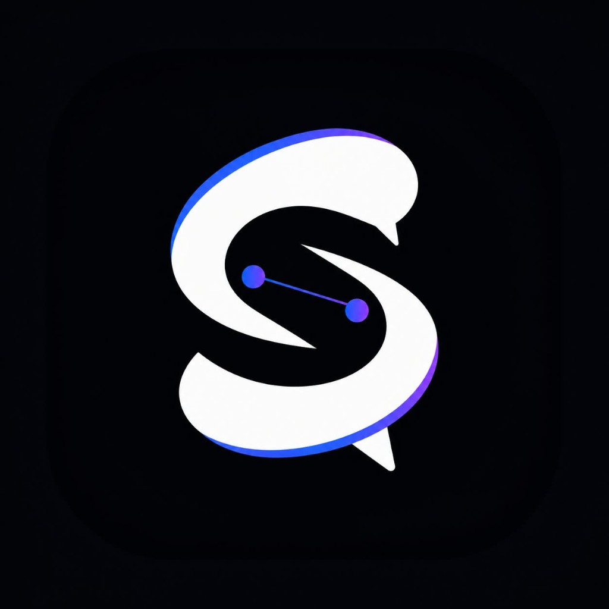

<p align="center">
    
</p>

<h1 align="center">Seamless for Android</h1>

<p align="center">
    <strong>A secure, decentralized, serverless peer-to-peer messaging system.</strong><br>
    Chat off-grid over Bluetooth Low Energy mesh networks, route globally via Tor v3 Onion Services, discover through Nostr relays, and share files instantly with HyperDrop.
</p>

<p align="center">
    <a href="https://github.com/bharathbharath20081607-cloud/seamless-android/releases"></a>
    <a href="LICENSE.md"></a>
    
    
    
</p>

> [!NOTE]
> Seamless operates with **zero central servers, zero accounts, zero phone numbers, and zero telemetry**. Everything runs entirely on your device and connects directly peer-to-peer.

---

## Overview

**Seamless** is an advanced peer-to-peer communication client engineered by Aquarius Groups. It provides private, censorship-resistant messaging across multiple complementary transports:

1. **Local Bluetooth Low Energy (BLE) Mesh (100% Offline)**: Communicate with nearby peers without internet, Wi-Fi, or cellular towers. Messages automatically hop across intermediate devices to reach distant recipients.
2. **Tor v3 Onion Services (Global Internet P2P)**: Private 1:1 and group communication routed through end-to-end encrypted Tor hidden services. IP addresses are completely masked with zero central servers.
3. **Nostr Relay Integration**: Location-based Geohash channels and decentralized discovery with configurable Proof-of-Work (PoW) anti-spam mining.
4. **HyperDrop (Wi-Fi Direct & Aware)**: Ultra-fast local device-to-device file and media transfer without internet or local Wi-Fi router access.

Seamless maintains **100% binary protocol compatibility** with the open Bluetooth mesh protocol used by the original iOS bitchat app, allowing seamless cross-platform communication between Android and iOS users over local mesh networks.

---

## Install Seamless

Download the latest release APK directly from the [GitHub Releases page](https://github.com/bharathbharath20081607-cloud/seamless-android/releases).

### Sideloading Instructions:
1. **Download the APK**: Download the latest `seamless-v1.5.1.apk` from the Releases tab on your Android device.
2. **Allow Unknown Sources**: If prompted, grant permission to your browser or file manager to install unknown apps (found under **Settings > Security** or **Settings > Apps & notifications > Special app access > Install unknown apps**).
3. **Install**: Tap the downloaded `.apk` file and confirm installation.

---

## Features

### 📡 Multi-Transport Networking
- **Decentralized BLE Mesh**: Autonomous peer discovery, advertisement, and multi-hop routing over Bluetooth Low Energy.
- **Tor Onion Services (v3)**: Built-in native Tor hidden services for private internet communication without server intermediaries or metadata leakage.
- **Nostr Relay Channels**: Connect to open Nostr relays for Geohash area channels and wide-area broadcast.
- **HyperDrop High-Speed File Transfer**: Direct Wi-Fi P2P file, photo, and voice memo streaming.
- **Store & Forward Offline Delivery**: Messages destined for offline peers are cached and automatically forwarded when recipients reappear on the mesh or Tor circuit.

### 🔒 End-to-End Cryptography
- **Double Ratchet Forward Secrecy**: Ephemeral key derivation using the Signal-style Double Ratchet algorithm and Noise Protocol framework.
- **Authenticated Encryption**: X25519 key agreements, Ed25519 identity signatures, AES-256-GCM, and ChaCha20-Poly1305.
- **Channel Security**: Argon2id password-derived key material for private group channels.
- **Proof-of-Work (PoW)**: Client-side cryptographic difficulty challenges on Nostr broadcasts to defeat spam without central moderators.

### 🛡️ Privacy & OpSec First
- **Zero Identity Footprint**: No accounts, phone numbers, emails, or central registries. Cryptographic identities are generated locally on-device.
- **Ephemeral In-Memory Storage**: Chats and session states are kept in secure volatile memory by default.
- **Emergency Panic Wipe**: Triple-tap the brand logo in the top bar to instantly erase all active cryptographic keypairs, message histories, cached peers, and reset identity state.
- **Cover Traffic & Noise Padding**: Configurable message padding and packet pacing to mitigate passive traffic analysis.

### 🎨 Modern Android Experience
- **Jetpack Compose UI**: Built with Material Design 3 and a bespoke **Obsidian & Optical Light** design system.
- **Interactive Emoji Reactions**: Real-time floating physics reactions synced across mesh, Tor, and private chats.
- **Voice Notes**: Built-in voice recording with live dynamic audio waveforms and low-latency compressed delivery.
- **Fast Media Transfers**: Automatic image downscaling, progressive chunking, and selective acknowledgment windowing.
- **Battery Optimization**: Adaptive power profiles adjust BLE scanning duty cycles, Tor circuit heartbeats, and worker frequencies based on battery percentage.

---

## Usage & Commands

Seamless features an IRC-inspired command line interface directly in the chat bar:

| Command | Action |
|:---|:---|
| `/j #channel` | Join or create a topic-based channel |
| `/m @nickname message` | Send an end-to-end encrypted direct message to a peer |
| `/w` | List active peers discovered on the mesh or Tor network |
| `/channels` | Discover active broadcast and group channels |
| `/block @nickname` | Block an offending peer from delivering messages to you |
| `/block` | List all currently blocked peers |
| `/unblock @nickname` | Unblock a previously blocked peer |
| `/clear` | Clear the current conversation message feed |
| `/pass [password]` | Set or update the encryption password for a channel (Owner only) |
| `/transfer @nickname` | Transfer channel administrative ownership to another peer |
| `/save` | Toggle persistent message retention for the channel (Owner only) |

### Quick Start:
1. Launch **Seamless** on your Android device (requires Android 8.0+).
2. Grant Bluetooth and Location permissions when prompted (required by Android OS for BLE hardware access).
3. The app automatically initializes local mesh networking and provisions a private Tor v3 onion service in the background.
4. Set your display nickname or use the auto-generated cryptographic handle.
5. Nearby peers will be discovered automatically. Join `#general` or start chatting in public mesh channels!

---

## Android Technical Architecture

```
┌────────────────────────────────────────────────────────┐
│                   Jetpack Compose UI                   │
│      Obsidian & Optical Light Design / ChatScreen      │
├────────────────────────────────────────────────────────┤
│                     ChatViewModel                      │
│        Unified State Machine & Event Dispatcher        │
├───────────────────┬────────────────────────────────────┤
│   Cryptographic   │  Double Ratchet & Noise Protocol   │
│      Engine       │  X25519 / Ed25519 / AES-256-GCM    │
├───────────────────┴────────────────────────────────────┤
│             Multi-Transport Routing Layer              │
├─────────────┬─────────────┬──────────────┬─────────────┤
│   BLE Mesh  │  Tor Onion  │ Nostr Relays │  HyperDrop  │
│  (Central / │   Services  │ (NIP-01/04)  │   (Wi-Fi    │
│ Peripheral) │  (P2P v3)   │   with PoW   │   Direct)   │
└─────────────┴─────────────┴──────────────┴─────────────┘
```

### Core Components:

- **[`SeamlessApplication.kt`](app/src/main/java/com/seamless/android/SeamlessApplication.kt)**: Application-level dependency injection, cryptographic identity bootstrap, and lifecycle management.
- **[`MainActivity.kt`](app/src/main/java/com/seamless/android/MainActivity.kt)**: Permission handling, hardware state observers, and Jetpack Compose navigation scaffold.
- **[`ChatViewModel.kt`](app/src/main/java/com/seamless/android/ui/ChatViewModel.kt)**: MVVM presentation logic managing active peers, mesh packets, Tor conversations, and UI state.
- **[`BluetoothMeshService.kt`](app/src/main/java/com/seamless/android/mesh/BluetoothMeshService.kt)**: Core BLE mesh engine operating simultaneous Central (scanner/client) and Peripheral (advertiser/server) roles.
- **[`TorCircuitManager.kt`](app/src/main/java/com/seamless/android/net/TorCircuitManager.kt)** & **[`TorMessagingService.kt`](app/src/main/java/com/seamless/android/net/TorMessagingService.kt)**: Tor v3 hidden service orchestration, persistent circuit keep-alives, connection pooling, and stream framing.
- **[`SeamlessRatchetManager.kt`](app/src/main/java/com/seamless/android/noise/SeamlessRatchetManager.kt)** & **[`DoubleRatchet.kt`](app/src/main/java/com/seamless/android/crypto/DoubleRatchet.kt)**: Signal-compatible Double Ratchet session state machine delivering post-compromise security and forward secrecy.
- **[`NostrDirectMessageHandler.kt`](app/src/main/java/com/seamless/android/nostr/NostrDirectMessageHandler.kt)**: Nostr protocol client with Proof-of-Work spam rejection.
- **[`HyperDropUtils.kt`](app/src/main/java/com/seamless/android/ui/fileshare/HyperDropUtils.kt)**: Wi-Fi Direct peer-to-peer file transfer engine.
- **[`BinaryProtocol.kt`](app/src/main/java/com/seamless/android/protocol/BinaryProtocol.kt)**: Binary packet serialization, 13-byte header encoding, chunk fragmentation, and bloom filter deduplication.

### Binary Protocol Specifications:
Seamless packets over Bluetooth LE utilize an optimized compact binary structure:
- **Header**: 13-byte fixed header including 1-byte packet type, 8-byte message ID, and 4-byte TTL / hop count (maximum 7 hops).
- **Fragmentation**: Transparent payload fragmentation for large messages, voice notes, and media buffers exceeding BLE MTU thresholds.
- **Routing**: Adaptive gossip flood routing with Bloom filter deduplication to prevent packet broadcast storms.

---

## Android Setup & Development

### Prerequisites
- **Android Studio**: Ladybug, Hedgehog, or newer
- **Android SDK**: API level 26 (Android 8.0) minimum, API 34+ target
- **Java Development Kit (JDK)**: JDK 17 or JDK 21
- **Kotlin**: 1.9.0+
- **Gradle**: 8.0+

### Build Instructions

1. **Clone the repository:**
   ```bash
   git clone https://github.com/bharathbharath20081607-cloud/seamless-android.git
   cd seamless-android
   ```

2. **Open in Android Studio:**
   - Launch Android Studio, select **Open**, and browse to the cloned `seamless-android` directory.
   - Wait for Gradle sync to index dependencies.

3. **Compile and run debug build:**
   ```bash
   ./gradlew assembleDebug
   adb install -r app/build/outputs/apk/debug/app-debug.apk
   ```

4. **Production Release Build:**
   ```bash
   ./gradlew assembleRelease
   ```

5. **Generate Android App Bundle (for Google Play):**
   ```bash
   ./gradlew bundleRelease
   ```

---

## Hardware & Permission Requirements

| Permission | Purpose |
|:---|:---|
| `BLUETOOTH_SCAN` / `BLUETOOTH_CONNECT` / `BLUETOOTH_ADVERTISE` | Mandatory on Android 12+ (API 31+) for BLE mesh discovery and connections. |
| `ACCESS_FINE_LOCATION` | Required by Android OS (API 26–30) to perform Bluetooth Low Energy hardware scans. Seamless does **not** track, log, or transmit GPS data. |
| `NEARBY_WIFI_DEVICES` | Required for HyperDrop Wi-Fi Direct peer-to-peer file transfer. |
| `RECORD_AUDIO` | Required exclusively when recording outgoing voice notes. |
| `POST_NOTIFICATIONS` | Foreground service status and incoming message alerts. |

**Hardware Requirements:**
- **Bluetooth LE**: BLE 4.2+ support with peripheral advertising capabilities.
- **Android OS**: Android 8.0 (API 26) or higher.
- **RAM**: 2 GB minimum (3 GB+ recommended for optimal Tor circuit operation).

---

## Cross-Platform Compatibility

Seamless is designed for open, cross-platform communication:
- **Android ↔ iOS Interoperability**: Full bidirectional messaging over Bluetooth mesh networks with iOS bitchat clients.
- **Shared Channels**: Seamless Android and iOS users can join and communicate within the same mesh channels.
- **Cryptographic Parity**: Identical X25519 key agreements and AES-GCM cipher suites across platforms.

---

## Security & Architecture Lineage

Seamless is built upon open-source research and engineering across the decentralized privacy ecosystem:
- **[bitchat](https://github.com/jackjackbits/bitchat)**: Core binary protocol specification and Bluetooth LE mesh routing foundations.
- **[Briar Project](https://code.briarproject.org/briar/briar)**: Embedded Tor daemon management, Bramble transport concepts, and resilient offline mailbox architectures.
- **[Signal Protocol](https://signal.org/docs/)**: Double Ratchet forward secrecy and post-compromise security models.
- **[Noise Protocol Framework](https://noiseprotocol.org/)**: Cryptographic session handshakes and mutual authentication.
- **[Nostr](https://github.com/nostr-protocol/nostr)**: Decentralized relay gossip and Proof-of-Work anti-spam protocols.

---

## Contributing

Contributions from security researchers, protocol engineers, and open-source developers are welcome!

1. Fork the repository.
2. Create your feature branch (`git checkout -b feature/cool-enhancement`).
3. Commit your changes with descriptive messages (`git commit -m 'feat: Add adaptive BLE pacing'`).
4. Push to your branch (`git push origin feature/cool-enhancement`).
5. Open a Pull Request.

---

## License

This project is licensed under the **MIT License**. See the [LICENSE](LICENSE.md) file for complete details.

---

<p align="center">
    <strong>Engineered with privacy by Aquarius Groups.</strong><br>
    <em>Zero central servers. Zero phone numbers. Pure encrypted communication.</em>
</p>
